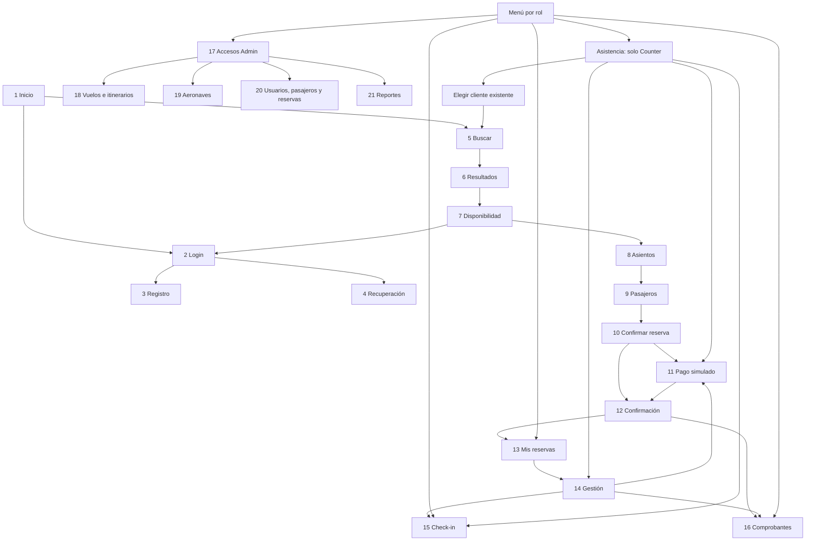

# Manual técnico — Aerolínea VIP

Autores: Jeremy Alexander Vilaña Guamán y Amaro Benjamin Caiza Sandoval.

## Tecnología y organización

Aplicación ASP.NET MVC 5 sobre .NET Framework 4.8.1. Utiliza SQL Server, Entity Framework, ASP.NET Identity, Razor, Bootstrap y jQuery. La base AerolineaVIP contiene los datos de la aerolínea; AerolineaVIP_Identity contiene las cuentas y roles.

Los controladores coordinan las solicitudes. Las entidades, validaciones y clases de cálculo concentran las reglas. Las vistas presentan los datos. El área Admin restringe sus acciones a Administrador y SuperUsuario; las operaciones de clientes comprueban la titularidad de las reservas en servidor.

## Condiciones de operación

- Siete asientos por aeronave: 1D, 2D, 2I, 3D, 3I, 4D y 4I.
- Tarifas calculadas en servidor y copiadas al registrar la reserva.
- Retención hasta 24 horas desde la creación o 2 horas antes del primer tramo, lo que ocurra primero.
- Cancelación de reserva pendiente sin costo; pagada con reembolso simulado del 80 % hasta 24 horas antes. Por vuelo cancelado, el Administrador tramita el 100 %.
- Check-in desde 24 horas hasta una hora antes de cada tramo, para asientos confirmados.
- Pagos simulados; una tarjeta terminada en 0000 se rechaza. No se guarda el número completo, vencimiento ni código de seguridad.
- Comprobantes académicos: confirmación CNF, factura ACAD y nota de crédito NC.
- El domingo se venden itinerarios completos de ida o regreso, con conexión en Guayaquil de al menos 60 minutos y la misma aeronave.
- La asignación de aeronaves es manual. La generación de vuelos no automatiza el plan propuesto DP-02.
- Recuperación de acceso de demostración, sin envío de correo; comprobantes sin validez tributaria.
## Pantalla N.º → nombre → ruta real

| Pantalla N.º | Nombre | Ruta real | Estado |
|---|---|---|---|
| 1 | Inicio | /Home/Index (también /) | Implementada |
| 2 | Iniciar sesión | /Account/Login | Implementada |
| 3 | Registro | /Account/Register | Implementada |
| 4 | Recuperación de acceso | /Account/ForgotPassword | Implementada, sin correo |
| 5 | Buscar vuelos | /Vuelos/Buscar | Implementada |
| 6 | Resultados | /Vuelos/Resultados | Implementada |
| 7 | Disponibilidad | /Vuelos/Disponibilidad?clave={vuelos}&cantidad={n} | Implementada |
| 8 | Selección de asientos | /Compra/Asientos | Implementada |
| 9 | Pasajeros | /Compra/Pasajeros | Implementada |
| 10 | Confirmar reserva | /Compra/Confirmar | Implementada |
| 11 | Pago simulado | /Compra/Pagar/{reservaId} | Implementada |
| 12 | Confirmación de compra/reserva | /Compra/Final/{reservaId} | Implementada |
| 13 | Mis reservas | /Reservas/MisReservas | Implementada |
| 14 | Gestión y cancelación | /Reservas/Gestion/{reservaId} | Implementada |
| 15 | Check-in | /CheckIn/Index (también /CheckIn) | Implementada |
| 16 | Comprobantes | /Comprobantes/Index (también /Comprobantes) | Implementada |
| 17 | Accesos administrativos | /Admin/Index | Implementada, sin dashboard |
| 18 | Vuelos e itinerarios | /Admin/Vuelos | Implementada |
| 19 | Aeronaves | /Admin/Aeronaves | Implementada |
| 20 | Usuarios, pasajeros y reservas | /Admin/Gestion | Implementada |
| 21 | Consultas y reportes | /Admin/Reportes (redirige a /Admin/Reportes/Ocupacion) | Implementada |

Resultados recibe OrigenId, DestinoId, Fecha (yyyy-MM-dd) y Pasajeros por GET. En disponibilidad, clave es el ID de un vuelo o dos IDs separados por coma; cantidad va de 1 a 7. Las pantallas 8–10 necesitan la selección validada en Session, iniciada mediante POST /Compra/Iniciar. Los IDs de reserva se obtienen de las reservas propias o de Asistencia autorizada, no se sustituyen los filtros de propiedad por parámetros de usuario.

Rutas complementarias: /Admin/Itinerarios y /Admin/TramosItinerario (18); /Admin/Gestion?pestana=usuarios|pasajeros|reservas (20); /Admin/Reportes/Reservas y /Admin/Reportes/Compras (21). Los comprobantes tienen /Comprobantes/VistaPrevia/{id} y /Comprobantes/Descargar/{id}. /Reservas/Cancelaciones atiende al Administrador por vuelos cancelados. /Reservas/Asistencia y /Reservas/NuevaCompra son exclusivas de EmpleadoCounter.

## Mapa de navegación

El menú muestra únicamente accesos apropiados; las autorizaciones efectivas siguen en servidor. Cliente y counter no entran a Admin. El counter cancela solo pendientes; SuperUsuario puede usar módulos Admin y sus flujos de cliente, pero Asistencia continúa exclusiva del counter.

