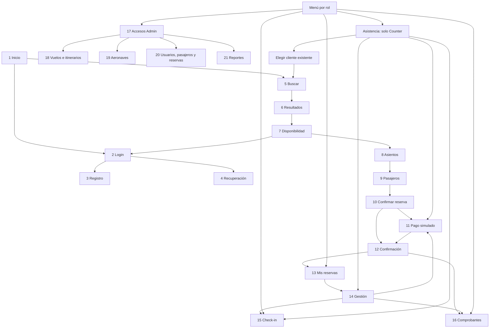

# Revisión final de entregables — FASE 5

Autores: Jeremy Alexander Vilaña Guamán y Amaro Benjamin Caiza Sandoval.

## Alcance y límite de la revisión

Revisión contra los 12 entregables y las 21 pantallas resumidos en CLAUDE.md, las rutas MVC reales y las políticas solicitadas por el grupo. Los PDF oficiales del docente y los wireframes no están en el repositorio: no se afirma una comparación literal de su diseño ni una aprobación de las propuestas DP.

Las fases 1–4 fueron probadas por el grupo. En el cierre se revisaron 105 vistas fuente (91 tipadas), sus inclusiones en el csproj y su codificación. Se corrigieron consultas de autenticación en dos plantillas, preparación de listas en vistas y archivos sin BOM UTF-8. Las condiciones y recorridos que solo presentan contenido, los controles visuales por rol y el formato de fechas/moneda se conservan; no se realizan consultas, cálculos de tarifas o reglas de negocio en las vistas.

## Los 12 entregables

| N.º | Entregable resumido | Estado | Evidencia / qué falta |
|---|---|---|---|
| 1 | Home con diseño propio | Completo | Home/Index, layout, Site.css y buscador. |
| 2 | Superusuario creado por código | Completo | Global.asax.cs: CrearRolesYUsuarios y CrearUsuario. |
| 3 | Administrador creado por código y con acceso limitado | Completo | admin01; controladores Admin autorizados; asignación de roles exclusiva de SuperUsuario. |
| 4 | Roles creados por código | Completo | RolesSistema.Todos y RoleManager en Global.asax.cs. |
| 5 | Usuarios iniciales creados por código | Completo | superusuario, admin01, counter01, cliente01. |
| 6 | Roles asignados por código | Completo | UserManager.AddToRole en la inicialización. |
| 7 | CRUD de tablas administrables | Completo | Aeropuertos, rutas, frecuencias, aeronaves, vuelos, itinerarios, tramos y pasajeros; catálogos solo lectura según alcance. |
| 8 | Login con nombre de usuario y contraseña | Completo | Account/Login, PasswordSignInAsync y validaciones. |
| 9 | Registro con usuario, correo, contraseña y rol | Completo | Account/Register. Público: Cliente; elección de otros roles solo por SuperUsuario, validada en servidor. |
| 10 | Las 21 interfaces | Completo según resumen | Acciones y vistas enumeradas abajo; para contraste visual literal faltan los PDF oficiales. |
| 11 | Mapa de navegación 11.4.2 | Completo según resumen | Menús por rol, retornos y enlaces entre flujos. Corregida continuación anónima hacia login y retorno a disponibilidad; SuperUsuario ve también sus accesos de cliente. |
| 12 | Base de datos, datos iniciales y funciones del alcance | Parcial: DP-02 manual | Ambos scripts SQL y flujos de compra, reserva, cancelación, check-in y PDF integrados. La asignación de aeronaves funciona manualmente; falta automatizar el plan propuesto DP-02 al generar vuelos. No se cambió ese planificador en este cierre porque no es una corrección menor y depende de su aprobación y programación operativa. |

No faltan pantallas del resumen. La recuperación de acceso es una demostración con respuesta neutral y token, sin correo, según lo solicitado. Los pagos y reembolsos son simulados; no se afirma cumplimiento tributario ni normativo.

## Pantalla N.º → nombre → ruta real

| Pantalla N.º | Nombre | Ruta real | Estado |
|---|---|---|---|
| 1 | Inicio | /Home/Index (también /) | Implementada |
| 2 | Iniciar sesión | /Account/Login | Implementada |
| 3 | Registro | /Account/Register | Implementada |
| 4 | Recuperación de acceso | /Account/ForgotPassword | Implementada, sin correo |
| 5 | Buscar vuelos | /Vuelos/Buscar | Implementada |
| 6 | Resultados | /Vuelos/Resultados | Implementada |
| 7 | Disponibilidad | /Vuelos/Disponibilidad?clave={vuelos}&cantidad={n} | Implementada |
| 8 | Selección de asientos | /Compra/Asientos | Implementada |
| 9 | Pasajeros | /Compra/Pasajeros | Implementada |
| 10 | Confirmar reserva | /Compra/Confirmar | Implementada |
| 11 | Pago simulado | /Compra/Pagar/{reservaId} | Implementada |
| 12 | Confirmación de compra/reserva | /Compra/Final/{reservaId} | Implementada |
| 13 | Mis reservas | /Reservas/MisReservas | Implementada |
| 14 | Gestión y cancelación | /Reservas/Gestion/{reservaId} | Implementada |
| 15 | Check-in | /CheckIn/Index (también /CheckIn) | Implementada |
| 16 | Comprobantes | /Comprobantes/Index (también /Comprobantes) | Implementada |
| 17 | Accesos administrativos | /Admin/Index | Implementada, sin dashboard |
| 18 | Vuelos e itinerarios | /Admin/Vuelos | Implementada |
| 19 | Aeronaves | /Admin/Aeronaves | Implementada |
| 20 | Usuarios, pasajeros y reservas | /Admin/Gestion | Implementada |
| 21 | Consultas y reportes | /Admin/Reportes (redirige a /Admin/Reportes/Ocupacion) | Implementada |

Resultados recibe OrigenId, DestinoId, Fecha (yyyy-MM-dd) y Pasajeros por GET. En disponibilidad, clave es el ID de un vuelo o dos IDs separados por coma; cantidad va de 1 a 7. Las pantallas 8–10 necesitan la selección validada en Session, iniciada mediante POST /Compra/Iniciar. Los IDs de reserva se obtienen de las reservas propias o de Asistencia autorizada, no se sustituyen los filtros de propiedad por parámetros de usuario.

Rutas complementarias: /Admin/Itinerarios y /Admin/TramosItinerario (18); /Admin/Gestion?pestana=usuarios|pasajeros|reservas (20); /Admin/Reportes/Reservas y /Admin/Reportes/Compras (21). Los comprobantes tienen /Comprobantes/VistaPrevia/{id} y /Comprobantes/Descargar/{id}. /Reservas/Cancelaciones atiende al Administrador por vuelos cancelados. /Reservas/Asistencia y /Reservas/NuevaCompra son exclusivas de EmpleadoCounter.

## Mapa de navegación verificado

El menú muestra únicamente accesos apropiados; las autorizaciones efectivas siguen en servidor. Cliente y counter no entran a Admin. El counter cancela solo pendientes; SuperUsuario puede usar módulos Admin y sus flujos de cliente, pero Asistencia continúa exclusiva del counter.

## Verificación y entrega

Resultado del cierre: MSBuild con MvcBuildViews=true terminó con 0 errores. Las dos pruebas de integración de compra y área del cliente pasaron; también pasó la prueba de navegación pública, de cliente, counter y administrativa. La auditoría estática verificó las 105 vistas, ambas conexiones y los dos scripts SQL requeridos.

- Auditoría estática: Pruebas/RevisionEntrega.ps1 -GuardarInventario; detalle por archivo en Inventario_Vistas.md.
- Compilación: MSBuild AerolineaVIP.slnx -t:Build -p:Configuration=Debug -p:MvcBuildViews=true -v:m.
- Integración: Pruebas/FlujoCompra.Integracion.ps1 y Pruebas/AreaCliente.Integracion.ps1 con la aplicación iniciada y su BaseUrl.
- Navegación: Pruebas/Navegacion.Integracion.ps1; incluye el retorno público desde login y las rutas administrativas reales.
- Autores del proyecto y pie de página: únicamente los dos integrantes indicados. Nombres de pasajeros de ejemplo y créditos de bibliotecas no representan autoría del proyecto.
- Conexiones verificadas: instancia predeterminada, Data Source=., autenticación SQL Server sa/123; bases AerolineaVIP y AerolineaVIP_Identity.
- Paquete de fuentes: excluye .git, .vs, bin, obj y packages en cualquier nivel. Conserva solución, proyecto, contenido, documentación, pruebas, BaseDatos/Script_BD_AerolineaVIP.sql y AerolineaVIP/Scripts/Ampliar_AspNetUsers.sql.
- Al extraer: restaurar paquetes NuGet, ejecutar los dos scripts en el orden de README.md y compilar. No se entrega una publicación precompilada.
- Empaquetado reproducible: Pruebas/PrepararEntrega.ps1 -Destino ruta-nueva.zip. Abre el ZIP, descomprime y compara cada archivo por SHA-256, comprueba exclusiones y scripts, y lista el primer nivel.
